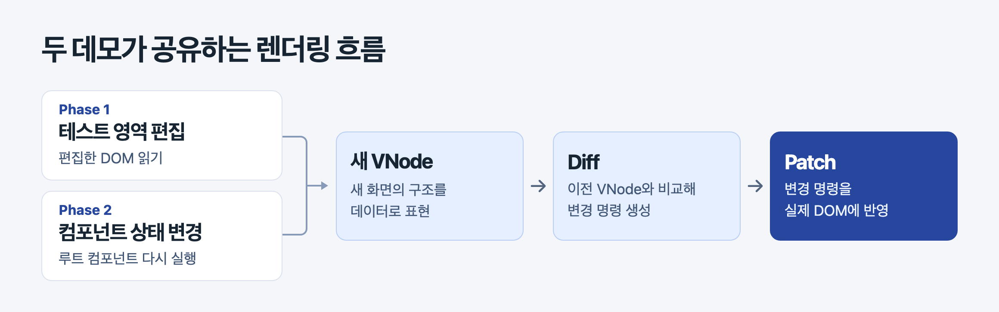
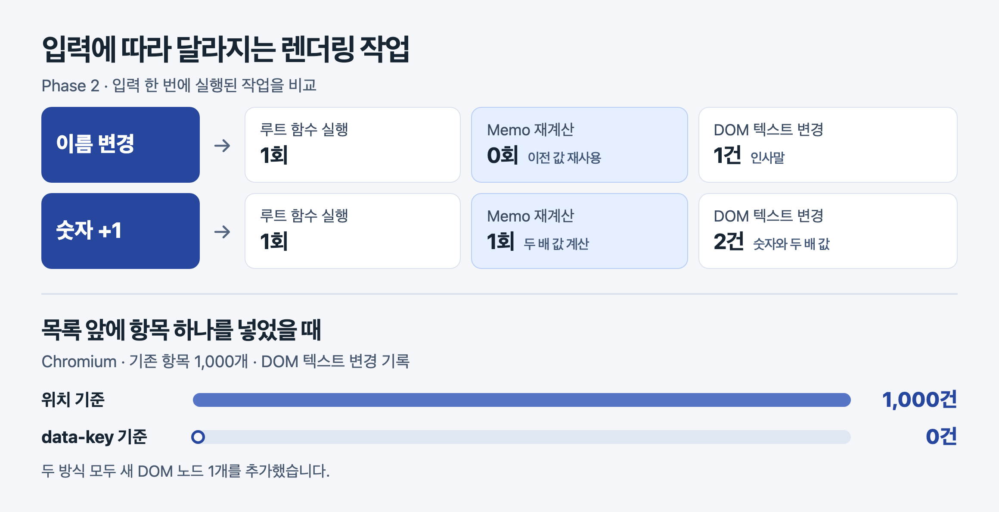
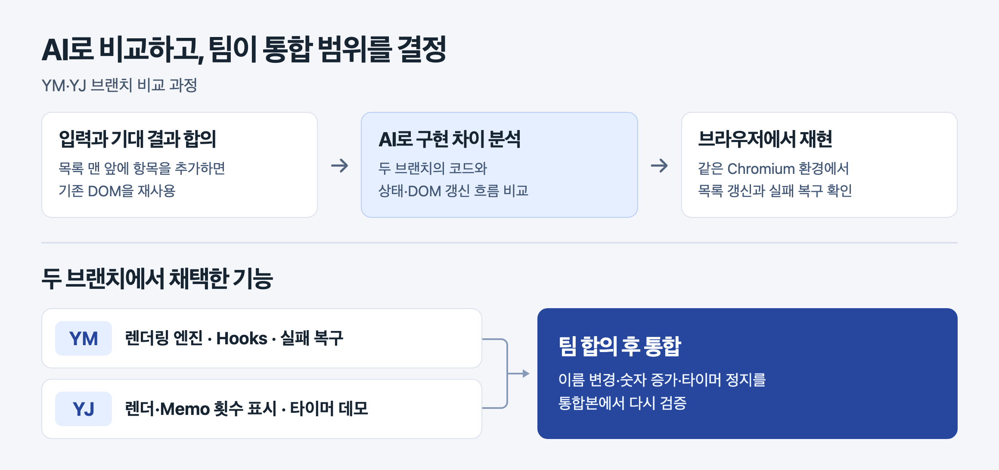

# Mini React

**DOM 편집과 상태 변경을 하나의 Diff·Patch 엔진으로 처리합니다.**

크래프톤 정글 팀 프로젝트 · HTML, CSS, Vanilla JavaScript, Node.js, Playwright

## 1. 프로젝트 목표와 구조

사용자 입력이 실제 DOM을 바꾸는 흐름을 구현하고, 브라우저에서 검증했습니다. Phase 1은 편집한 DOM을 읽고, Phase 2는 루트 컴포넌트를 실행해 새 VNode를 만듭니다. 두 Phase 모두 이전 VNode와 비교한 뒤 필요한 변경을 실제 DOM에 반영합니다.

## 2. 두 가지 데모

### Phase 1 · 편집과 이력 복원

[Phase 1 데모 열기](http://127.0.0.1:5173/demos/phase1/)

### Phase 2 · 상태 변경과 Hooks

[Phase 2 데모 열기](http://127.0.0.1:5173/demos/phase2/)

## 3. 차별점과 검증

Phase 2 데모에서 **루트 실행, Memo 계산, DOM 변경**을 입력별로 확인할 수 있습니다. 최근 Diff 명령과 성공한 반영 횟수도 함께 기록합니다.

## 4. AI 활용과 협업

팀이 입력과 기대 결과를 먼저 정하고, AI로 두 브랜치의 구현을 비교했습니다. 같은 Chromium 환경에서 동작을 확인한 뒤 통합 범위를 결정했습니다.

