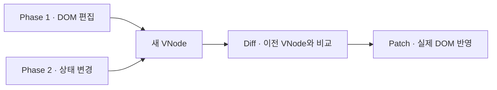
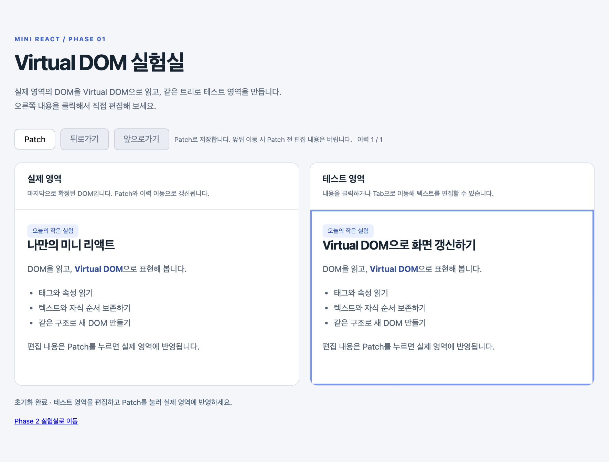
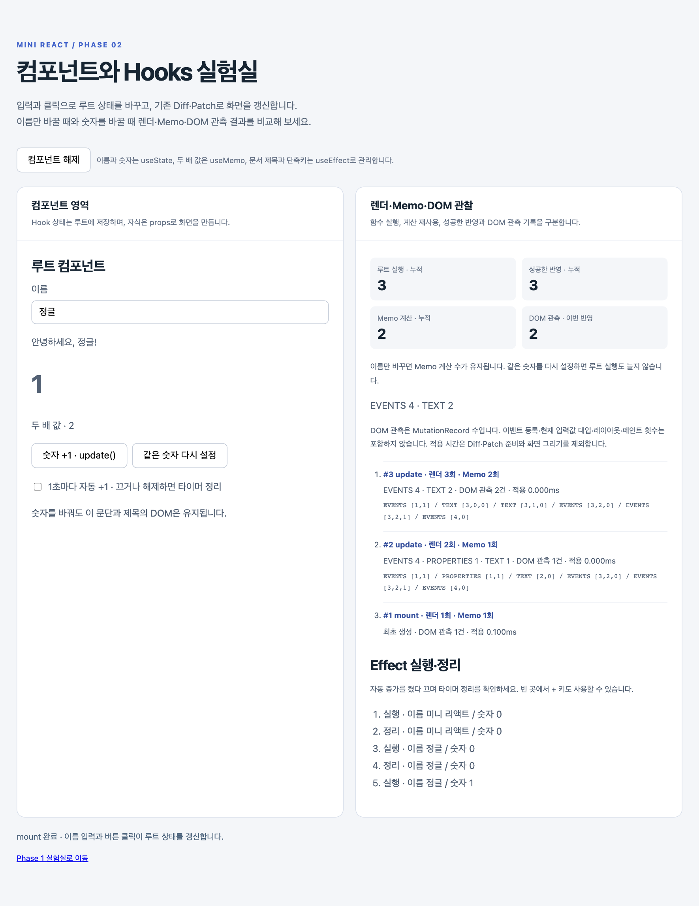

# Mini React

**DOM 편집과 상태 변경을 하나의 Diff·Patch 엔진으로 처리합니다.**

크래프톤 정글 팀 프로젝트 · HTML, CSS, Vanilla JavaScript, Node.js, Playwright

## 1. 프로젝트 목표와 구조

사용자 입력이 실제 DOM을 바꾸는 흐름을 구현하고, 브라우저에서 검증했습니다. Phase 1은 편집한 DOM을 읽고, Phase 2는 루트 컴포넌트를 실행해 새 VNode를 만듭니다. 두 Phase 모두 이전 VNode와 비교한 뒤 필요한 변경을 실제 DOM에 반영합니다.



## 2. 두 가지 데모

저장소 루트에서 `npm run dev`로 로컬 서버를 시작하면 아래 링크로 열 수 있습니다. 첫 실행 전에는 `npm ci`로 의존성을 설치합니다.

### Phase 1 · 편집과 이력 복원

[Phase 1 데모 열기](http://127.0.0.1:5173/demos/phase1/)

오른쪽 **테스트 영역**의 제목을 바꾸고 **Patch**를 누르면 왼쪽 실제 영역에 반영됩니다. 반영에 성공한 VNode는 이력에 저장합니다. **뒤로가기·앞으로가기**로 두 영역을 함께 복원할 수 있습니다. [이력 코드](demos/phase1/history.js)



### Phase 2 · 상태 변경과 Hooks

[Phase 2 데모 열기](http://127.0.0.1:5173/demos/phase2/)

루트 `FunctionComponent`가 Hook 값을 보관합니다. 함수가 다시 실행돼도 `useState`는 호출 순서에 따라 같은 위치에서 값을 읽습니다. 자식 카운터는 루트가 전달한 props로 화면을 만듭니다. [Hooks 코드](src/component/hooks.js)



| 시연 | 화면에서 확인할 동작 |
| --- | --- |
| 이름 바꾸기 → 숫자 +1 | 이름을 바꾸면 루트는 다시 실행되고, 숫자를 바꿀 때 두 배 값이 다시 계산됩니다. |
| 자동 증가 켜기 → 끄기 | `useEffect`가 타이머를 정리하면 숫자 증가가 멈춥니다. |

## 3. 차별점과 검증

| 차별점 | 브라우저에서 확인한 결과 |
| --- | --- |
| **렌더링 과정 관찰** | 이름만 바꾸면 루트 실행 수가 늘고 Memo 계산 수는 유지됩니다. 숫자를 바꾸면 Memo 계산도 늘어납니다. 데모에서 성공한 반영 수와 DOM 변경 기록도 확인할 수 있습니다. [데모 테스트](tests/browser/integration.spec.js) |
| **`data-key`로 DOM 재사용** | Chromium에서 기존 항목 1,000개 앞에 하나를 추가했습니다. 텍스트 변경 기록은 **위치 기준 1,000건 → key 기준 0건**이었고, 노드 추가는 양쪽 모두 1개였습니다. [비교 테스트](tests/browser/p1-02.spec.js) |
| **Patch 실패 시 복구** | DOM 쓰기 도중 예외를 발생시켰을 때 마지막 확정 화면으로 복구하고, 같은 변경을 다시 적용할 수 있는지 확인했습니다. 이력과 Hook 상태는 DOM 반영에 성공한 뒤 확정합니다. [복구 테스트](tests/browser/p1-02.spec.js) |

통합본 `0460131`에서 **Playwright 테스트 44개**를 통과했습니다. 목록 삽입 수치는 해당 시나리오에서 기록한 DOM 변경 건수입니다. [검증 기준](docs/requirements.md)

## 4. AI 활용과 협업

1. **입력과 기대 결과를 먼저 정했습니다.** 목록 앞에 항목을 삽입하면 기존 DOM을 재사용하고, Patch 도중 실패하면 이전 화면과 상태로 돌아와야 한다는 식으로 비교 기준을 정했습니다.
2. **AI로 두 브랜치의 구현을 분석하고 브라우저에서 비교했습니다.** 같은 Chromium 환경에서 목록 갱신과 실패 복구를 재현했습니다. AI가 정리한 코드 차이를 실제 DOM과 상태의 변화로 확인했습니다.
3. **팀이 통합 범위를 결정했습니다.** YM의 엔진·Hooks·실패 복구를 기반으로 YJ의 렌더·Memo 횟수 표시와 타이머 데모를 연결했습니다. 통합 뒤에는 이름 변경·숫자 증가·타이머 정지를 다시 검사했습니다. [통합 PR #29](https://github.com/kylekim0868-cpu/krafton-jungle-framework/pull/29) · [통합 테스트](tests/browser/integration.spec.js)

<details>
<summary>로컬에서 실행하고 검증하기</summary>

저장소 루트에서 Node.js 22 이상으로 실행합니다.

```sh
npm ci
npm run dev
```

자동 검사는 `npm run test:install`을 처음 한 번 실행한 뒤 `npm run verify`로 실행합니다.

</details>
